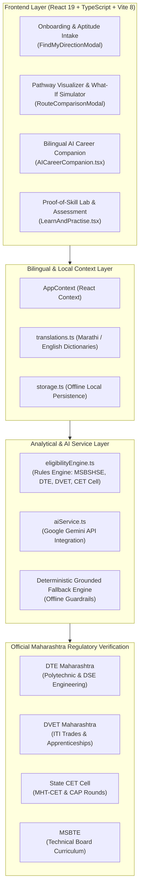

# KaushalyaDisha (कौशल्यदिशा)

[](https://react.dev/)
[](https://www.typescriptlang.org/)
[](https://vitejs.dev/)
[](https://tailwindcss.com/)
[](https://ai.google.dev/)
[](https://motion.dev/)
[](#seva-innovation-hackathon)

> **Discover your direction. Build your future.**  
> *कौशल्यांना दिशा, भविष्याला नवी संधी.*  
> **Built for the Seva Innovation Hackathon**

**KaushalyaDisha** is a Maharashtra-centric, AI-assisted career awareness, education pathway planning, and skill verification platform. Built specifically to eliminate educational misinformation and career paralysis among Class 8–12, ITI, and Polytechnic students across Maharashtra, the platform delivers mathematically verified academic roadmaps, official government portal cross-references, and bilingual AI counseling in both **Marathi (मराठी)** and **English**.

---

## 🏛️ System Architecture



---

## 🌟 Key Capabilities & Differentiators

### 1. Grounded Maharashtra Educational Pathways
- **Post-SSC Routes (Class 10):** Standardized trajectories into **FYJC (Arts, Science, Commerce)**, **3-Year Polytechnic Diplomas (MSBTE)**, and **ITI Vocational Trades (DVET)**.
- **Lateral Entry & DSE Engineering:** Explicit guidance on Direct Second Year Engineering admission (DSE) without requiring MHT-CET, including cutoff trends, CAP round stages, and reservation categories.
- **Zero Hallucination Mandate:** The platform never invents college cutoffs or fee structures; all criteria link directly to official state authority portals (`dte.maharashtra.gov.in`, `mahacet.org`, `admission.dvet.gov.in`).

### 2. Dual-Engine AI Career Companion (Bilingual)
- **State-Grounded Prompts:** Powered by Google Gemini (`@google/genai`) with guardrails that anchor responses in authentic Maharashtra vocational curricula.
- **Seamless Marathi & English Fluency:** Real-time language switching across the entire platform, ensuring tier-2, tier-3, and rural learners receive guidance in their native language.
- **Deterministic Offline Fallbacks:** When API credentials are not provided or network access is offline, the companion smoothly transitions to pre-compiled, verified advice maps, guaranteeing uninterrupted usability.

### 3. "What-If" Pathway Simulator & Comparison Engine
- Dynamic side-by-side comparative analysis of diverging educational choices:
  - *Degree vs. 3-Year Polytechnic Diploma*
  - *Estimated tuition and scholarship eligibility (EBC, TFWS, SC/ST/OBC concessions)*
  - *Time-to-employment timelines and starting salary ranges*

### 4. Proof-of-Skill Passport
- Replaces unverified attendance certificates with a verifiable portfolio of submitted practical assignments, mini-projects, and assessment scores.

---

## 🛠️ Technology Stack

| Domain | Technologies |
|---|---|
| **Frontend Framework** | React 19.0.1, Vite 8.3.0, TypeScript 7.0 |
| **Styling & Animation** | Tailwind CSS v4.3.3, Motion 12.23 (Framer Motion), Lucide React 0.546 |
| **Backend & Execution** | Express 4.21.2, Node.js 22+, `tsx` 4.21 TypeScript runner |
| **AI SDK** | `@google/genai` 2.4.0 (Gemini 2.5/3.8 API integration) |
| **Serverless Deployment** | Vercel Serverless Functions (`@vercel/node`) |

---

## 📂 Project Directory Structure

```text
KaushalyaDisha/
├── api/                      # Vercel serverless functions (AI proxy & gateway)
├── src/
│   ├── components/
│   │   ├── common/           # EligibilityBadge, EvidenceBadge, OfficialSourceLink, Header, Footer
│   │   ├── companion/        # AICareerCompanion interface with bilingual toggle
│   │   ├── explore/          # CareerExplorer, CareerDetailModal
│   │   ├── landing/          # Hero banner, feature highlights, student testimonials
│   │   ├── learn/            # AssessmentRunner, LearnAndPractise, ActivitySubmissionModal
│   │   ├── onboarding/       # FindMyDirectionModal (intake questionnaire)
│   │   ├── pathways/         # PathwayExplorer, RouteComparisonModal, WhatIfSimulator
│   │   └── profile/          # Student profile view and Proof-of-Skill passport
│   ├── context/
│   │   └── AppContext.tsx    # Central state provider (language, student profile, saved paths)
│   ├── data/
│   │   ├── activities.ts     # Skill challenges and practical assignments
│   │   ├── careers.ts        # Comprehensive database of Maharashtra career roles
│   │   ├── demoProfiles.ts   # Curated demo personas (SSC graduate, rural polytechnic aspirant)
│   │   ├── pathways.ts       # Structured educational nodes and transitions
│   │   └── translations.ts   # Bilingual dictionary (Marathi & English)
│   ├── services/
│   │   ├── aiService.ts      # Gemini API client with fallback heuristic engine
│   │   ├── eligibilityEngine.ts # Rules engine for CAP rounds, TFWS, and cutoffs
│   │   └── storage.ts        # LocalStorage wrapper for client-side persistence
│   ├── types/
│   │   └── index.ts          # Domain schemas (Pathway, Career, StudentProfile, Translation)
│   ├── App.tsx               # Primary application routing and shell
│   ├── index.css             # Tailwind CSS v4 design tokens
│   └── main.tsx              # Application entry point
├── server.ts                 # Local development Express server
├── package.json              # Project dependencies and npm scripts
├── tsconfig.json             # TypeScript compiler configuration
├── vercel.json               # Serverless rewrites and build configurations
└── vite.config.ts            # Vite bundler configuration with React and Tailwind plugins
```

---

## 🚀 Getting Started

### Prerequisites
- **Node.js**: `v18.0.0` or higher (Node 20+ or 22+ recommended)
- **npm** or **pnpm**
- **Google Gemini API Key**: (Optional, but recommended for live LLM responses)

### 1. Clone the Repository
```bash
git clone https://github.com/swaraj0160/KaushalyaDisha.git
cd KaushalyaDisha
```

### 2. Install Dependencies
```bash
npm install
```

### 3. Environment Setup
Copy the reference configuration file:
```bash
cp .env.example .env
```
Populate your Gemini API key in `.env`:
```env
GEMINI_API_KEY="your-gemini-api-key"
```
*(Note: If `GEMINI_API_KEY` is not provided, the platform automatically activates its verified offline fallback engine without errors.)*

### 4. Run Development Server
```bash
npm run dev
```
Navigate to [http://localhost:5173](http://localhost:5173) in your browser.

### 5. Production Build
```bash
npm run build
npm run preview
```

---

## 🏛️ Official Regulatory Authorities Referenced

All academic logic, admission milestones, and scholarship information conform to guidelines published by:
- **DTE Maharashtra:** Directorate of Technical Education ([dte.maharashtra.gov.in](https://dte.maharashtra.gov.in))
- **DVET Maharashtra:** Directorate of Vocational Education & Training ([admission.dvet.gov.in](https://admission.dvet.gov.in))
- **MSBSHSE:** Maharashtra State Board of Secondary and Higher Secondary Education ([mahahsscboard.in](https://mahahsscboard.in))
- **State CET Cell:** Government of Maharashtra State Common Entrance Test Cell ([mahacet.org](https://mahacet.org))
- **MahaDBT:** Maharashtra Direct Benefit Transfer Portal for post-matric scholarships ([mahadbt.maharashtra.gov.in](https://mahadbt.maharashtra.gov.in))

---

## 🤝 Contributing

Contributions to improve Maharashtra career roadmaps and educational clarity are welcomed!
1. Check [CONTRIBUTING.md](CONTRIBUTING.md) for contribution guidelines.
2. Ensure any newly introduced educational pathways link to verifiable state government notifications or board curricula.
3. Verify bilingual translations in `src/data/translations.ts`.

---

## 📄 License & Hackathon Context

Developed by **Swaraj Ingale** ([@Swaraj0160](https://github.com/Swaraj0160)) for the **Seva Innovation Hackathon**.  
Released under the [MIT License](LICENSE).
