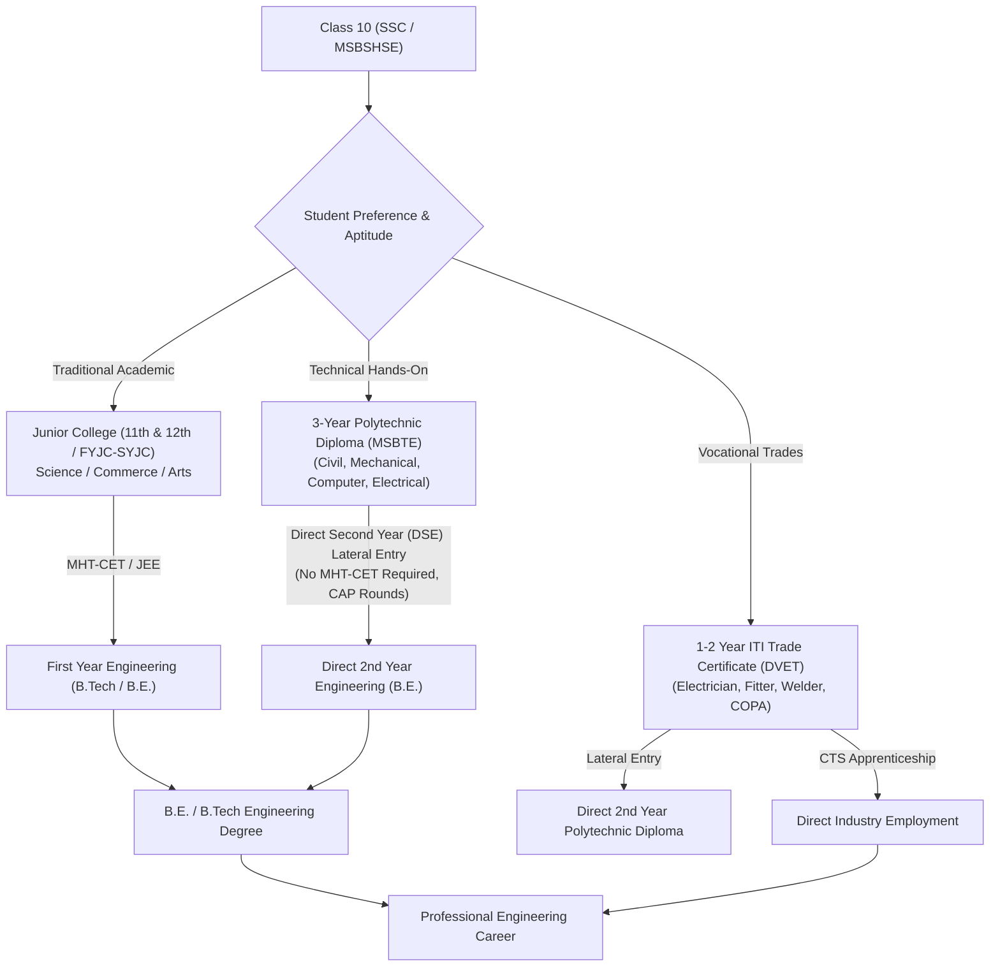
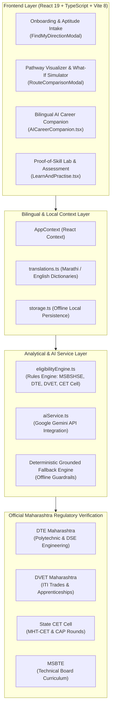

# KaushalyaDisha (कौशल्य दिशा)

<p align="center">
  <strong>Grounded Maharashtra Education & Vocational Career Pathway Platform</strong><br>
  <em>कौशल्यांना दिशा, भविष्याला नवी संधी — AI-assisted educational roadmaps, DTE/DVET lateral entry planning, and bilingual guidance for Class 8–12 and Polytechnic students.</em>
</p>

<p align="center">
  
  
  
  
  
  
  
</p>

---

## Overview

**KaushalyaDisha (कौशल्य दिशा)** is a Maharashtra-centric, AI-assisted career awareness, educational pathway planning, and vocational skill verification platform engineered for the **Seva Innovation Hackathon**. Built to combat educational misinformation, high dropout rates, and career paralysis among rural and semi-urban Class 8–12, ITI, and Polytechnic students across Maharashtra, the platform delivers mathematically verified academic trajectories, official government regulatory cross-references, and bilingual AI counseling in both **Marathi (मराठी)** and **English**.

Unlike generic career advice chatbots that invent unrealistic degrees or overlook state-specific affirmative admission processes, KaushalSetu models the authentic Maharashtra educational landscape: **MSBSHSE** (SSC/HSC), **MSBTE** (Diploma), **DTE Maharashtra** (Polytechnic & Direct Second Year Engineering / DSE), **DVET** (ITI trades), and the **State CET Cell** (MHT-CET CAP rounds).

---

## The Vocational Guidance Deficit & The KaushalyaDisha Solution

### The Challenge
- **Urban Guidance Bias:** Educational guidance platforms overwhelmingly assume a student will take 4-year urban university degrees, completely ignoring low-cost high-leverage vocational routes like ITI trades and 3-Year Polytechnic Diplomas.
- **Regulatory Confusion (CAP & Lateral Entry):** Rural students and their parents are frequently unaware that completing a 3-Year Polytechnic diploma entitles them to **Direct Second Year (DSE)** engineering admissions without writing the MHT-CET exam.
- **Language & Cultural Exclusion:** The majority of high-quality career portals are exclusively in English, isolating Marathi-medium learners in Tier-2, Tier-3, and rural regions.
- **Hallucinated Fees & Bogus Cutoffs:** Opaque educational consultants provide inaccurate fee structures and false cutoff claims, misleading families into severe educational debt.

### The KaushalyaDisha Solution
- **Grounded Maharashtra Regulatory Topology:** Explicitly models official state pathways: SSC → Polytechnic Diploma → DSE Engineering (B.E./B.Tech) or SSC → ITI → CTS/CITS Apprenticeships.
- **Official Portal Cross-Referencing:** Every cutoff, scholarship scheme (EBC, TFWS, SC/ST/OBC fee concessions), and admission deadline links directly to authoritative portals (`dte.maharashtra.gov.in`, `mahacet.org`, `admission.dvet.gov.in`).
- **Native Marathi & English Fluency:** Real-time bilingual dictionary (`translations.ts`) allowing seamless toggling between Marathi and English across all assessment modules and AI conversations.
- **Dual-Engine AI Companion with Offline Fallback:** Integrates Google Gemini (`@google/genai`) with structured system prompts grounded in state curricula, backed by a deterministic heuristic fallback engine when offline.

---

## Maharashtra Academic & Lateral Entry Architecture



---

## Core Implemented Capabilities

### 1. Grounded Maharashtra Educational Pathways
- **Post-SSC Standardized Routes:** Clear, unambiguous pathways into **FYJC (Arts, Science, Commerce)**, **3-Year Polytechnic Diplomas (MSBTE)**, and **ITI Vocational Trades (DVET)**.
- **Direct Second Year (DSE) Advisory:** Detailed eligibility rules, CAP round schedules, merit calculation formulas, and reservation benefits (TFWS, EBC).
- **Zero Hallucination Mandate:** Transparent college fee structures and cutoff trends linked to official Maharashtra state gazettes.

### 2. Bilingual AI Career Companion (`AICareerCompanion.tsx`)
- **State-Grounded Guidance:** Powered by Google Gemini (`@google/genai`) with system guardrails anchoring advice in authentic Maharashtra technical boards.
- **Full Marathi & English Parity:** Instant single-click language toggle across all career profiles, aptitude challenges, and diagnostic questions.
- **Deterministic Offline Fallbacks:** Operates seamlessly even without an API key or internet connection, serving verified regional roadmap data from local cache.

### 3. "What-If" Pathway Comparison Simulator
- Dynamic side-by-side comparative analysis of diverging educational options:
  - *4-Year B.Tech vs. 3-Year Polytechnic Diploma + DSE*
  - *Total fee outlays factoring in EBC / TFWS fee waivers*
  - *Time-to-employment benchmarks and starting stipend ranges*

### 4. Proof-of-Skill Practical Lab
- Interactive skill assessments and mini-projects (`LearnAndPractise.tsx`) that validate practical problem-solving rather than rote classroom memorization.
- Generates a tamper-proof digital skill passport for apprenticeship applications.

---

## Architecture & System Workflow



---

## Technology Stack

Verified directly from source code and package configurations:

| Component | Technology | Description |
|---|---|---|
| **Frontend Framework** | React 19.0.1, Vite 8.3.0, TypeScript 7.0 | High-performance reactive UI with instant hot module replacement |
| **Styling & Motion** | Tailwind CSS v4.3.3, Motion 12.23 (Framer) | Responsive mobile-first layouts with smooth drawer transitions |
| **AI Client SDK** | `@google/genai` 2.4.0 (Google Gemini) | Multi-turn conversational AI with custom Maharashtra system prompts |
| **Backend & Execution** | Express 4.21.2, Node.js 22+, `tsx` 4.21 | Serverless gateway proxy for Gemini API requests |
| **State & Localization** | React Context & Native LocalStorage | Low-overhead zero-dependency bilingual state and profile cache |
| **Component Primitives** | Lucide React 0.546 | Clear, accessible iconography for academic and vocational routes |

---

## Repository & Directory Structure

```text
KaushalyaDisha/
├── api/                      # Vercel serverless functions (AI proxy & gateway)
├── src/
│   ├── components/
│   │   ├── common/           # EligibilityBadge, OfficialSourceLink, Header, Footer
│   │   ├── companion/        # AICareerCompanion interface with bilingual toggle
│   │   ├── explore/          # CareerExplorer, CareerDetailModal
│   │   ├── landing/          # Hero banner, feature highlights, student testimonials
│   │   ├── learn/            # AssessmentRunner, LearnAndPractise, ActivitySubmissionModal
│   │   ├── onboarding/       # FindMyDirectionModal (intake questionnaire)
│   │   ├── pathways/         # PathwayExplorer, RouteComparisonModal, WhatIfSimulator
│   │   └── profile/          # Student profile view and Proof-of-Skill passport
│   ├── context/
│   │   └── AppContext.tsx    # Central state provider (language, student profile, saved paths)
│   ├── data/
│   │   ├── activities.ts     # Skill challenges and practical assignments
│   │   ├── careers.ts        # Comprehensive database of Maharashtra career roles
│   │   ├── demoProfiles.ts   # Curated demo personas (SSC graduate, rural polytechnic aspirant)
│   │   ├── pathways.ts       # Structured educational nodes and transitions
│   │   └── translations.ts   # Bilingual dictionary (Marathi & English)
│   ├── services/
│   │   ├── aiService.ts      # Gemini API client with fallback heuristic engine
│   │   ├── eligibilityEngine.ts # Rules engine for CAP rounds, TFWS, and cutoffs
│   │   └── storage.ts        # LocalStorage wrapper for client-side persistence
│   ├── types/
│   │   └── index.ts          # Domain schemas (Pathway, Career, StudentProfile)
│   ├── App.tsx               # Primary application routing and shell
│   └── main.tsx              # React mounting entrypoint
├── server.ts                 # Local development Express server
├── package.json              # Dependencies and build scripts
└── vite.config.ts            # Vite bundler configuration
```

---

## Getting Started & Local Development

### Prerequisites
- **Node.js**: `v20.0.0` or higher
- **npm** or **pnpm**
- **Google Gemini API Key**: (Optional — the app smoothly degrades to offline heuristics if omitted)

### 1. Clone the Repository
```bash
git clone https://github.com/Swaraj0160/KaushalyaDisha.git
cd KaushalyaDisha
```

### 2. Configure Environment Variables
Copy `.env.example` to `.env`:
```bash
cp .env.example .env
```
Add your Gemini API key:
```env
GEMINI_API_KEY=your_gemini_api_key_here
```

### 3. Install Dependencies
```bash
npm install
```

### 4. Start Development Server
```bash
npm run dev
```
Navigate to `http://localhost:5173` to launch KaushalyaDisha.

---

## Author & Acknowledgements

- **Lead Engineer & System Architect:** **Swaraj Ingale** ([@Swaraj0160](https://github.com/Swaraj0160))
- **Hackathon:** Built for the **Seva Innovation Hackathon**
- **Regulatory References:**
  - Directorate of Technical Education, Maharashtra ([DTE](https://dte.maharashtra.gov.in/))
  - Directorate of Vocational Education & Training ([DVET](https://admission.dvet.gov.in/))
  - Maharashtra State Board of Technical Education ([MSBTE](https://msbte.org.in/))
  - State Common Entrance Test Cell ([CET Cell](https://mahacet.org/))
